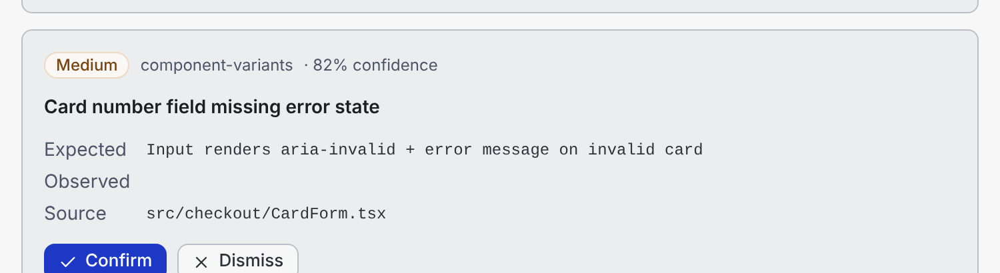
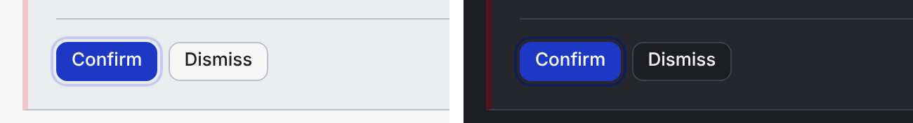
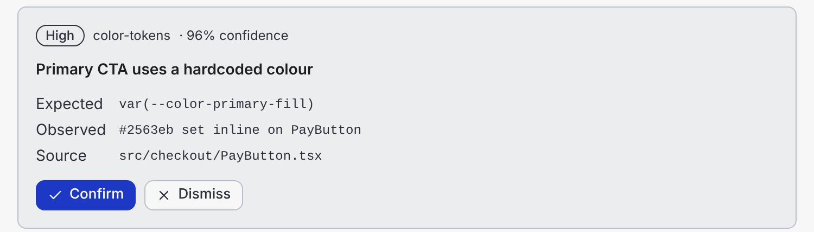

# Evidence report

**Status, 21 Oct 2026:** the checker and eval set work and are reproducible. Two models (ChatGPT 6.1 Sol and Claude Opus 5.5, both at medium) each generated the panel once in a clean session from the same single file. Both passed every structural check on the first attempt. Human review then found one real accessibility defect the checker missed. The review and repair prompts haven't been exercised yet, because neither generation needed repair.

## What was tested

The structural checker (`checker/check.mjs`) against 11 cases: 10 hand-built (`evals/cases/`). Nine are single-purpose mutations of the reference panel (`evals/make-cases.py`); one is a frozen earlier version of the reference; case 11 is an unedited real generation. Each case's `expected.json` was written before the checker was run on it.

The checker bundles a candidate, renders all four states against `contract/fixtures.ts` with stub versions of Foundry's components, and runs 21 checks mapped to DC Drift's categories and severities.

## Results

Final run (`npm run eval`, full output in `evals/RESULTS.md`):

| Case | Expected to fail | Observed | Score | Gate | True verdict |
|---|---|---|---|---|---|
| 01 compliant | — | — | 100 | GO | GO |
| 02 hardcoded hex | TOK-1 | TOK-1 | 95 | REVIEW | REVIEW |
| 03 wrong token names | TOK-2, TOK-3 | TOK-2, TOK-3 | 90 | HOLD | HOLD |
| 04 wrong semantic family | TOK-3 | TOK-3 | 95 | REVIEW | REVIEW |
| 05 missing labels | A11Y-1, A11Y-2 | A11Y-1, A11Y-2 | 90 | HOLD | HOLD |
| 06 missing screen (empty state) | STA-3 | STA-3 | 95 | HOLD | HOLD |
| 07 incomplete evidence | EVD-2 | EVD-2 | 95 | HOLD | HOLD |
| 08 disallowed component | CMP-1, CMP-2 | CMP-1, CMP-2 | 90 | HOLD | HOLD |
| 09 false-positive traps | — | — | 100 | GO | GO |
| 10 hover contrast | — (human-only) | — | 100 | **GO** | **REVIEW** |
| 11 GPT focus ring (real generation) | — (human-only) | — | 100 | **GO** | **REVIEW** |

Detection matched expectations in 11/11 cases. The gate matched the true verdict in 9/11. Cases 10 and 11 are the misses: both are defects the checker cannot see (contrast and focus visibility), one built by hand and one found in a real generation.

**First run, before fixes** (`evals/RESULTS-run1.md`): 8/10. Case 08 crashed the render (11 spurious failures; gate correct for the wrong reason) and case 09 produced a false positive. Both were checker bugs (M3, M4 below). The expectations were not changed between runs; `results-run1.json` and `results.json` confirm this.

*Case 07 — what the eval exists to prevent: a finding nobody can verify, one click from "Confirm".*

## Live generations

Full notes in `RUN-LOG.md`; code, raw responses and checker reports in `runs/`.

| | ChatGPT 6.1 Sol | Claude Opus 5.5 |
|---|---|---|
| Structural checks, first attempt | 21/21 (after fixing harness flaw M5) | 21/21 |
| Defect found only by human review | Focus outline nearly invisible: 1.36:1 light, 1.05:1 dark (min. 3:1) | Loading state not announced; `aria-pressed` on one-time actions |
| Minor | "1 … findings hidden"; footer shown with 0 hidden | Adds local decision state not in the brief |
| Honesty of its own notes | Said contrast and interaction weren't tested | Flagged focus-token gap and possible wording mismatch |

*GPT's generation with keyboard focus on Confirm. The focus outline is faint in light mode and almost disappears in dark.*

What this shows, and what it doesn't:
- The contract was enough for two different models to meet every structural rule first time. That's one run each, at one setting, on one brief.
- The checker didn't distinguish them. Human review did.
- The serious defect was in an area the instruction file never mentioned (focus). The cheapest fix is a rule in `AI-INSTRUCTIONS.md`, then a check.

## Findings

**F1 — DC Drift's score thresholds alone would have shipped every defective case.** With 21 checks, one failed check costs ~5 points, so a missing screen scores 95 — above the ≥80 GO threshold. Under the raw thresholds, all seven defective cases (02–08) would have been GO. The gate here adds two rules taken from DC Drift's own severity definitions: any failed HIGH check → HOLD ("blocks release"), any failed MEDIUM → at least REVIEW ("requires fix before release"). DC Drift's `rules.md` currently states both the severity rules and the thresholds, and they contradict each other for small check suites. That should be fixed in DC Drift itself.

**F2 — Foundry's hover tokens fail contrast with their own contrast text.** `contrastText` is computed against `fill` only. In the light theme `fill-hover` is lighter than `fill`:

| Pair | Ratio | WCAG AA (4.5:1) |
|---|---|---|
| white on `--color-primary-fill` | 8.71 | pass |
| white on `--color-primary-fill-hover` | 3.76 | **fail** |
| white on `--color-error-fill-hover` | 3.21 | **fail** |

The instruction file now says to use `fill-active` for hover. The real fix belongs in `@foundry-ds/core` (compute contrast text per state, or darken on hover in light mode).

**F3 — Foundry's own React app doesn't consume Foundry's tokens.** `packages/web` styles everything with shadcn's default HSL variables (`--primary`, `--muted-foreground`); only four `--foundry-*` hex values are defined. So there are two token contracts in one repo. This workflow picks Foundry's `--color-*` contract for the generated layer and bans shadcn colour utilities there (TOK-4). The shadcn components themselves still carry shadcn classes internally; reconciling the two is out of scope.

**F4 — Wrong token names fail silently.** In case 03, `var(--color-danger-bg)` resolves to nothing; the HIGH badge just loses its colour, with no build or runtime error. That's why an unknown token is HIGH (TOK-2), not MEDIUM.

## Mistakes I made

- **M1 — Text fusion.** The first checker run failed my own reference on CNF-1: adjacent elements' text concatenated ("Dismiss" + "1 hidden" → "Dismiss1 hidden"), breaking a word boundary. Fixed by spacing tags before parsing.
- **M2 — My reference failed contrast and passed every check.** The first reference used `fill-hover` on the Confirm button (F2). It scored 21/21. I only caught it by looking at the rendered panel and then measuring. Kept as case 10.
- **M3 — Placeholder modules for disallowed imports.** My first approach (a Proxy behind CommonJS interop) exported nothing, so case 08 crashed the whole ready state. The second attempt used a regex that matched across import statements and read the wrong names. Fixed by generating an ES module with exactly the imported names.
- **M4 — False positive on strings.** CMP-2 flagged `<button>` inside a string literal. Fixed by blanking string contents before the raw-element scan.

- **M5 — Harness rendered without handlers.** The first check of the GPT generation said HOLD because no finding could be confirmed. GPT disables actions when no `onDecision` handler is passed, which is defensible; my harness passed no handlers, which never happens in a real app. Fixed by passing no-op handlers. The 10 hand-built cases still matched after the fix.

## What's not proven

- **Generation quality beyond one brief.** Two models, one run each, one setting, one interface. A first observation, not a benchmark.
- **The review and repair prompts.** Neither generation needed structural repair, so prompts 02 and 03 are untested. The human review in `RUN-LOG.md` was done by me, not by an independent reviewer or the review prompt.
- **Generalisation.** I wrote the checker, the cases and the expectations, and fixed checker bugs against these cases. The two real generations acted as a small held-out test: the checker raised one false alarm (M5) and missed one real defect (case 11).
- **Adoption.** Nobody else has used it. A first usability observation is planned (`USABILITY-TEST.md`); one person is not evidence of team adoption.

## Limitations

- **Stubs, not real components.** The checker renders against minimal stubs with Foundry's prop signatures, not the real shadcn/Base UI components. Behaviour inside the components (focus rings, real disabled styling) isn't tested. Separately, Foundry's `button.tsx` appears to use Tailwind v4 syntax (`ring-3`, `--spacing(4)`) while `packages/web` depends on Tailwind 3 — worth checking before using the real components as the substrate.
- **Structural only.** No visual comparison (DC Drift's second layer), no contrast measurement, no dark-mode-specific checks.
- **Static render.** Filter behaviour and `onDecision` arguments aren't tested (AC-15). An interaction test with jsdom would close this.
- **Copy-coupled checks.** STA-3, CNF-1, CNF-2 and EVD-2 look for the brief's wording ("No findings", "Needs human review", "Evidence incomplete"). A generator that paraphrases will fail them, and a generator could pass by inserting the words. Deliberate, since copy is in the brief, but brittle.
- **No focus check.** Case 11 shows focus indicators matter in practice. A static check for focus-ring token pairs below 3:1 is the next check worth adding.
- **One fixture.** Six findings. Edge cases (no evidence object at all, all findings hidden, very long titles) aren't covered.
- **Coarse score.** Coverage-based scoring makes the number weakly informative; the gate rules carry the decision (F1).
