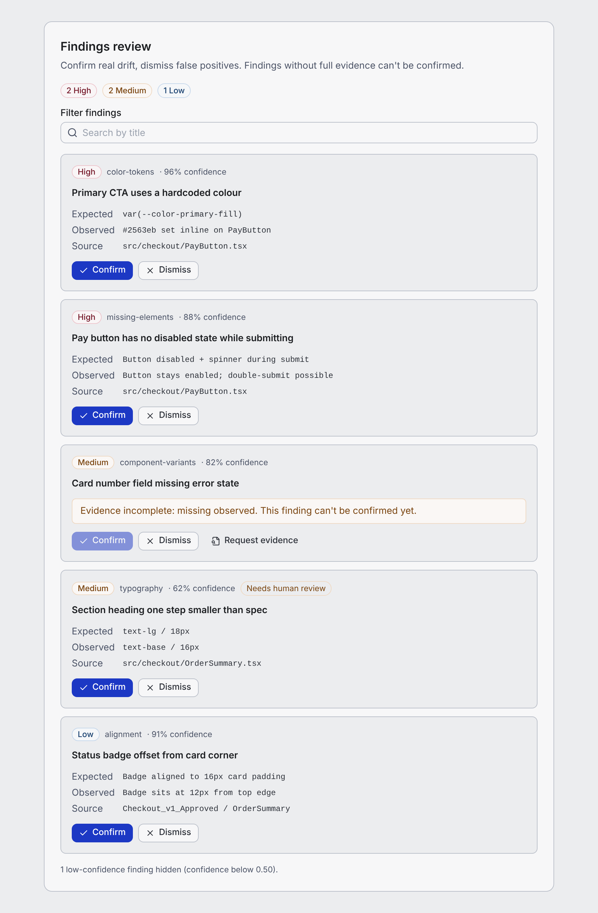

# Foundry AI UI workflow

A small, reproducible example of a system AI generates UI against: a design-system contract, prompts, a quality gate and an eval set that keeps the gate honest. It's built on [Foundry](https://github.com/alphaTango911/foundry)'s token system and implements the structural layer of [DC Drift](https://github.com/alphaTango911/dc-drift)'s verification rules as code.

Scope is deliberately one interface: a **findings review panel**, where someone decides which design-drift findings are real before release.



## What's here

| | |
|---|---|
| [`BRIEF.md`](BRIEF.md) | User, task, reference design, acceptance criteria — each mapped to a check |
| [`AI-INSTRUCTIONS.md`](AI-INSTRUCTIONS.md) | The contract for the model: allowed components, every Foundry token name, accessibility and behaviour rules |
| [`prompts/`](prompts) | Generate, review, repair |
| [`checker/`](checker) | Renders a candidate in all four states and runs 21 structural checks with DC Drift severities and a release gate |
| [`evals/`](evals) | 11 cases (10 deliberately built, 1 real generation) with expectations written before running them |
| [`runs/`](runs) + [`RUN-LOG.md`](RUN-LOG.md) | Real generations from two models, with checker reports and review notes |
| [`EVIDENCE.md`](EVIDENCE.md) | Expected vs observed, what I got wrong, what isn't proven |
| [`QUICKSTART.md`](QUICKSTART.md) | Reproduce it in ~15 minutes |
| [`reference/`](reference) | My hand-built panel — the calibration answer |

## Results so far

- **Two models ran the workflow cold.** ChatGPT 6.1 Sol and Claude Opus 5.5 each generated the panel once from the same single file. Both passed all 21 structural checks on the first attempt.
- **Human review found what the checker couldn't.** GPT's focus outline is nearly invisible (1.36:1 light, 1.05:1 dark), in an area my instructions didn't cover. Kept as eval case 11.
- **The checker is calibrated.** It matches expectations on 11/11 eval cases. Its release gate matches the true verdict on 9/11; both misses are contrast/focus defects no structural check can see.
- **It found problems in my own tools.** DC Drift's score thresholds alone would have marked every defective case GO. Foundry's hover tokens fail WCAG AA against their own contrast text (3.76:1). Foundry's React app doesn't consume Foundry's tokens.
- **Not yet done:** the review and repair prompts (neither generation needed repair), and a usability test with someone else.

## Run it

```bash
npm install
node checker/check.mjs reference/FindingsReviewPanel.tsx --out out/reference
npm run eval
```

MIT, like Foundry.
